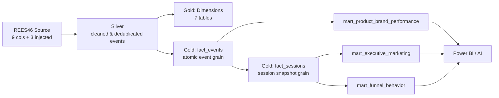

 feature/batch-streaming-ingestion
# Retail-Clickstream-Pipeline
=======
 data-modeling
# E-Commerce Clickstream Analytics — Gold Layer

Data modeling and data marts for an e-commerce clickstream platform, built with the **Kimball dimensional modeling lifecycle** on **Delta Lake** (Azure Databricks / Microsoft Fabric OneLake) and consumed by **Power BI**.

> **My part of the project:** the Gold layer — star schema design (dimensions + facts), the three business data marts, data-quality constraints, seed data, and the idempotent build scripts.

---

## Table of Contents

1. [Project Overview](#1-project-overview)
2. [Architecture](#2-architecture)
3. [Source Data (12 Features)](#3-source-data-12-features)
4. [Dimensional Model](#4-dimensional-model)
5. [Fact Tables](#5-fact-tables)
6. [Data Marts & KPIs](#6-data-marts--kpis)
7. [Constraints & Data Quality](#7-constraints--data-quality)
8. [Idempotency & Re-runs](#8-idempotency--re-runs)
9. [Repository Contents & How to Run](#9-repository-contents--how-to-run)
10. [Design Decisions (Why we did it this way)](#10-design-decisions-why-we-did-it-this-way)
11. [Known Limitations & Notes](#11-known-limitations--notes)

---

## 1. Project Overview

The platform processes the **REES46 eCommerce clickstream** dataset (~8.2M raw interactions, ~117K products, ~709K users). The Gold layer turns cleaned event logs into an analytics-ready warehouse that serves:

- **BI analysts** — fast dashboards and funnel analysis in Power BI, with no complex joins.
- **ML / AI consumers** — structured, historically accurate data.

**In numbers**

| 7 Dimensions | 2 Fact Tables | 3 Data Marts | 3 Views | 12 Source Features |
|:-:|:-:|:-:|:-:|:-:|
| Product (SCD2), User (SCD1), Date, Time, Platform, Channel, Event Type | `fact_events`, `fact_sessions` | Executive & Marketing, Funnel & Behavior, Product & Brand | 2 role-playing + 1 hourly activity | 9 native + 3 synthetic |

---

## 2. Architecture



- **Methodology:** Kimball Lifecycle (business process → fact type → grain → dimensions → measures → physical design).
- **Storage / engine:** Delta Lake tables (Databricks Runtime 13.3 LTS+; later aligned to Microsoft Fabric / OneLake with Power BI Direct Lake).
- **Medallion layers:** Source → Silver → **Gold** → Marts → BI.

---

## 3. Source Data (12 Features)

| # | Column | Origin | Purpose |
|---|--------|--------|---------|
| 1 | `event_time` | Native | Event timestamp (UTC); drives date/time keys and durations |
| 2 | `event_type` | Native | `view`, `cart`, `remove_from_cart`, `purchase` |
| 3 | `product_id` | Native | Durable business key for products |
| 4 | `category_id` | Native | Numeric category key (nullable) |
| 5 | `category_code` | Native | Dotted hierarchy, e.g. `computers.network.router` |
| 6 | `brand` | Native | Brand name (`Unknown` when null) |
| 7 | `price` | Native | Price at event time — non-additive on views, becomes revenue on purchases |
| 8 | `user_id` | Native | Persistent customer key |
| 9 | `user_session` | Native | Session identifier (degenerate dimension) |
| 10 | `platform` | Injected | `web` / `mobile` — constant within a session |
| 11 | `marketing_channel` | Injected | `organic` / `paid` / `email` / `social` — constant within a session |
| 12 | `ingestion_time` | Injected | Pipeline arrival time; used for ingestion delay & late-event detection |

---

## 4. Dimensional Model

| Dimension | Type | Key | Notes |
|-----------|------|-----|-------|
| `gold.dim_product` | **SCD Type 2** | `product_key` (surrogate), `product_id` (business key) | Keeps history via `valid_from` (inclusive) / `valid_to` (exclusive) / `is_current`. `category_code` is split into `category_level1..3`. Nulls become `'Unknown'`. |
| `gold.dim_user` | SCD Type 1 | `user_key` / `user_id` | No changing attributes, so changes overwrite. |
| `gold.dim_date` | Role-playing, static | `date_key` (YYYYMMDD) | 2019-01-01 → 2030-12-31 (4,383 days). Includes `is_weekend`, `iso_week`, `is_seasonal_peak`. |
| `gold.dim_time` | Role-playing, static | `time_key` (seconds since midnight, 0–86399) | 86,400 rows. `time_category`: Morning (06–11), Peak (12–17), Evening (18–22), Night (23–05). |
| `gold.dim_platform` | Lookup | `platform_key` | 1 = web, 2 = mobile |
| `gold.dim_marketing_channel` | Lookup | `channel_key` | 1 = organic, 2 = paid, 3 = email, 4 = social |
| `gold.dim_event_type` | Lookup | `event_type_key` | 1 = view, 2 = cart, 3 = remove_from_cart, 4 = purchase |

**Role-playing views** (no data duplication): `gold.dim_ingestion_date` and `gold.dim_ingestion_time` reuse `dim_date` / `dim_time` for the ingestion timestamp.

**Default member:** `dim_product` contains an `Unknown` row with `product_key = -1` so fact foreign keys are never null.

**Why split Date and Time?** A combined date+time dimension would need ~378M rows (4,383 × 86,400). Splitting gives 4,383 + 86,400 = **90,783** rows.

---

## 5. Fact Tables

Two fact tables, because the business process has **two different grains**. Mixing them would double-count revenue (e.g. a session with $100 revenue and 4 events would sum to $400).

| | `gold.fact_events` | `gold.fact_sessions` |
|---|---|---|
| **Pattern** | Transactional (atomic) | Accumulating snapshot |
| **Grain** | One deduplicated event | One browsing session |
| **Primary key** | `event_id` (hash of session, time, type, product) | `session_key` = `xxhash64(user_session)` |
| **Write strategy** | Append-only | Row updated as session events arrive |
| **Partitioned by** | `event_date_key` | `session_start_date_key` |
| **Foreign keys** | 10 (product, user, event type, event date/time, ingestion date/time, platform, channel, session) | 5 (user, date, time, platform, channel) |
| **Used for** | Product-, hour- and category-level analysis | Funnel, sessions, channel performance |

**`fact_events` measures**

| Measure | Additivity | Definition |
|---|---|---|
| `event_price` | Non-additive | Price shown at event time |
| `revenue` | Additive | `event_price` on purchase, else 0 |
| `event_count` | Additive | Always 1 |
| `ingestion_delay_seconds` | Not summed | `ingestion_ts − event_ts` |

Other notable columns: `event_ts` (replay clock), `source_event_ts` (original REES46 time), `ingestion_ts`, `product_key` (version valid at `event_ts`), `product_id` (durable key), and `is_bot` (copied from the session).

**`fact_sessions` highlights**

- Funnel flags: `has_view`, `has_cart`, `has_purchase` (0/1)
- Counters: `view_count`, `cart_count`, `purchase_count`, `events_per_session`
- Time: `session_duration_seconds` (0 for single-event sessions), `time_to_first_cart_seconds` (**NULL** when no cart — intentional, since 0 would mean an instant add-to-cart)
- Value: `session_cart_value`, `session_revenue`
- Quality flags: `is_bot`, `is_first_session`, `is_impossible_sequence`

---

## 6. Data Marts & KPIs

All marts store **only additive measures** (counts and sums). Ratios are computed in Power BI as `Σ numerator ÷ Σ denominator`, because an average of ratios gives wrong results when re-aggregated across days/channels. Bots are excluded from all marts (but kept in the facts for quality analysis).

### 6.1 `mart_executive_marketing` — Executive & Marketing
**Grain:** session start date × platform × channel  **Source:** `fact_sessions`

| KPI | Formula |
|---|---|
| Revenue | `Σ total_revenue` |
| Orders | `Σ total_orders` (sessions with ≥ 1 purchase) |
| AOV | `Σ total_revenue ÷ Σ total_orders` |
| Session conversion rate | `Σ total_orders ÷ Σ total_sessions` |
| Sessions per channel | `Σ total_sessions` by channel |
| New vs. returning | `Σ first_sessions` vs. `Σ returning_sessions` |

Revenue is attributed to the session's own channel (last-touch).

### 6.2 `mart_funnel_behavior` — Product & UX Funnel
**Grain:** session start date × platform × channel  **Source:** `fact_sessions`  **Population:** sessions with a view (`has_view = 1`)

| KPI | Formula |
|---|---|
| Funnel conversion rate | `Σ purchase_sessions ÷ Σ view_sessions` |
| View → Cart rate | `Σ cart_sessions ÷ Σ view_sessions` |
| Cart abandonment % | `Σ abandoned_cart_sessions ÷ Σ cart_sessions` |
| Lost revenue | `Σ lost_revenue` (cart value of abandoned sessions) |
| Avg. dwell time | `Σ sum_dwell_time_seconds ÷ Σ view_sessions` |
| Events per session | `Σ sum_events ÷ Σ view_sessions` |
| Avg. time to first cart | `Σ sum_time_to_first_cart_seconds ÷ Σ cart_sessions` |

`no_view_sessions` is stored for transparency (excluded from funnel ratios).

### 6.3 `mart_product_brand_performance` — Catalog / Merchandising
**Grain:** event date × platform × channel × product  **Source:** `fact_events`

| KPI | Formula |
|---|---|
| View-to-cart rate | `Σ total_carts ÷ Σ total_views` |
| View-to-purchase rate | `Σ total_purchases ÷ Σ total_views` |
| Avg. displayed price | `Σ sum_view_price ÷ Σ total_views` |
| High views / low sales | high `total_views` AND low `total_purchases` |
| Price band conversion | rates grouped by `price_band` (Low / Mid / High / Unknown) |
| Brand attention vs. purchase share | brand share of views vs. share of purchases (join to `dim_product`) |

Price bands use `ntile(3)` over each product's average view price, joined on `product_id` so all versions of a product share one band.

### 6.4 `gold.vw_hourly_activity` (view)
Hourly views / carts / purchases / revenue by date, hour, platform, channel and `category_level1` (bots excluded). Calculated at query time — no build step. Supports traffic-heatmap and promo-surge analysis.

### KPI → Team mapping

| Team | Mart |
|---|---|
| Executive & Marketing | `mart_executive_marketing` |
| Product & UX (Funnel) | `mart_funnel_behavior` |
| Merchandising / Category | `mart_product_brand_performance` |

---

## 7. Constraints & Data Quality

| Type | Behavior | Applied to |
|---|---|---|
| **Primary keys** | Informational (not enforced by Databricks) | 9 tables (7 dims + 2 facts) |
| **Foreign keys** | Informational | 10 on `fact_events`, 5 on `fact_sessions` |
| **CHECK constraints** | **Enforced** — violating writes fail | see below |

Enforced CHECKs: `valid_from < valid_to`, `event_price > 0`, `revenue >= 0`, `is_bot IN (0,1)`, `event_count = 1`, `ingestion_delay_seconds >= 0`, valid 0/1 session flags, and valid session measures (`events_per_session >= 1`, non-negative duration/values, `session_start_ts <= session_end_ts`).

Because PK/FK aren't enforced, key integrity relies on the load logic (deduplication by `event_id`, correct product-version join).

---

## 8. Idempotency & Re-runs

- **DDL:** every table uses `CREATE TABLE IF NOT EXISTS`.
- **Constraints:** each `ADD CONSTRAINT` is preceded by `DROP CONSTRAINT IF EXISTS`. Primary keys are dropped with `CASCADE` (Databricks refuses to drop a PK still referenced by FKs), so the **block order matters: PKs → FKs → CHECKs**.
- **Seed data:** static dimensions use `INSERT OVERWRITE`; the `Unknown` product row uses `INSERT ... WHERE NOT EXISTS` so real product data is never wiped.
- **Marts:** built with `INSERT INTO ... REPLACE WHERE date_key BETWEEN ...` — an atomic delete-and-insert for the chosen date range. Re-running gives identical numbers (no double counting), and late-arriving files are fixed by rebuilding just their dates.

---

## 9. Repository Contents & How to Run

| File | Description |
|---|---|
| `data_model_and_marts.sql` | Full Gold layer build script (v1.1) |
| `Clickstream_Gold_Layer_Documentation.docx` | Technical documentation with diagrams |
| `Discussion_QA_Data_Modeling.docx` | Discussion Q&A (Arabic) |
| `Gold_Layer_Explained_AR.pdf` | Detailed walkthrough of the SQL (Arabic) |
| `Gold_Layer_Interview_Study_Guide.pdf` | Study guide (Arabic) |
| `Columns.txt`, `KPIs.txt`, `Explain_KPIs.txt` | Column definitions and KPI lists per team (Arabic) |

**Run order of `data_model_and_marts.sql`**

| Section | Content | When |
|---|---|---|
| 0 | Drop retired v1.0 objects (commented out — destructive) | Once, only when upgrading |
| 1 | Schema, dimensions, facts | Once; safe to re-run |
| 2 | Marts and views | Once; safe to re-run |
| 3 | PK / FK / CHECK constraints | After tables exist; skippable if the workspace lacks key-constraint support |
| 4 | Seed data (lookups, date, time, Unknown product) | Once; safe to re-run |
| 5 | Mart build queries | **After every Gold load** |

If you use Unity Catalog, uncomment and edit `USE CATALOG <your_catalog>;` at the top of the script.

---

## 10. Design Decisions (Why we did it this way)

- **Two facts, not one:** two grains (event, session). Mixing them double-counts revenue.
- **Accumulating snapshot for sessions:** the session row is updated as new events arrive; events never change, so they are append-only.
- **Date and Time split:** 90,783 rows instead of ~378M; both reused as role-playing dimensions (event time and ingestion time).
- **SCD2 only for `dim_product`:** price, brand and category changes affect historical analysis; users and lookups don't need history.
- **Degenerate dimensions:** `user_session` and `event_id` live in the facts — no separate table needed. `xxhash64(user_session)` gives a compact integer join key.
- **Marts store sums, not ratios:** ratios are computed at report time so they stay correct at any aggregation level.
- **Bots stay in facts, out of marts:** keeps bot analysis possible while keeping business KPIs clean.

---

## 11. Known Limitations & Notes

- **Mart build date range is hardcoded** to `20190101–20301231` (full rebuild each run). This is correct and safe for the current data size; for incremental loads, replace the literals with `:from_key` / `:to_key` parameters in each query.
- **`time_category` hours are a proposal** and should be confirmed against the traffic heatmap.
- **`is_seasonal_peak` defaults to `FALSE`** for every date; natural peaks (e.g. Black Friday) are marked manually later, never from the injected anomaly window.
- **Remove-from-cart events** are stored in `fact_events` but not counted in the current marts.
- **No quantity column** in the source data — each purchase event counts as one unit at its event price.
- **Platform and channel are synthetic** (injected) and assumed constant within a session.
- **Platform note:** the original build targeted Azure Databricks; the project documentation later describes the move to Microsoft Fabric / OneLake. The SQL itself is standard Delta Lake DDL/DML.

---

## Author

**Youssef Mahmoud Abu Ali** — Big Data Architecture & Cloud Engineering
=======
# E-Commerce Content-Based Recommender System

An end-to-end, high-performance Content-Based Recommendation System engineered for large-scale e-commerce catalogs. The system transforms unstructured behavioral event logs and rich product metadata into a real-time, time-decayed feature space, delivering sub-second personalized item recommendations across a catalog of **117,286 products** and **709,231 profiled users**.

---

## 1. Project Overview & Business Core

### Problem Statement
In large-scale e-commerce environments, users face choice overload when navigating multi-hundred-thousand-item catalogs. Collaborative filtering methods frequently struggle with extreme sparsity, long-tail product distribution, and high cold-start velocity for newly listed items. Conversely, naive content-based systems fail to capture short-term user intent shifts and price sensitivities.

### Architecture Goals
1. **Production-Grade Personalization**: Construct granular user interaction profiles that continuously decay older interaction signals while over-weighting intent-rich events (such as carts and purchases).
2. **Sub-Second Inference**: Serve real-time top-$K$ recommendations via low-latency sparse matrix operations without requiring full online model re-training.
3. **Enterprise Scalability Roadmap**: Establish an offline prototype in Python (Pandas/SciPy/Scikit-Learn) with clean modularization designed to transition directly to PySpark, Delta Lake, and Microsoft Fabric OneLake for distributed big data processing.

---

## 2. Data Diagnosis & Exploratory Insights

### Dataset Scale & Interaction Funnel
The underlying dataset comprises an implicit behavioral stream over a 7-day window:
* **Product Catalog**: $117,286$ distinct products with text metadata (category, subcategory, brand) and price points.
* **Interaction Events**: $8,248,730$ raw user events ($8,248,119$ post-deduplication).
* **Behavioral Funnel**:
  * **Views (`view`)**: $\approx 85\%$ of total events (low implicit signal).
  * **Carts (`cart`)**: $\approx 10\%$ of total events (medium-to-high intent signal).
  * **Purchases (`purchase`)**: $\approx 5\%$ of total events (strongest conversion signal).

### Data Quality & Cleaning Rigor
* **Exact Temporal Deduplication**: Duplicate events generated within identical timestamps (`event_ts`) per user-item pair were eliminated to prevent artificial weight inflating.
* **Text Namespacing**: Category, department, and brand metadata were namespaced (e.g., `brand:apple`, `category:smartphone`) prior to TF-IDF tokenization. This prevents generic terms or missing token placeholders like `'Unknown'` from creating false feature similarities across disparate product categories.
* **Price Transformation (`log1p` & Non-Centered Scaling)**:
  * Raw prices display extreme positive skewness spanning multiple orders of magnitude ($1$ to $2,500+$).
  * Applied $y = \log(1 + \text{price})$ to stabilize variance.
  * Normalized continuous price vectors using a non-centered `RobustScaler` (scaling by IQR while keeping zero baselines) to ensure numeric feature scales align seamlessly with TF-IDF cosine spaces without destroying sparse matrix efficiency.

---

## 3. Module-by-Module Technical Breakdown

```
                  +-----------------------------------+
                  |   Raw Events & Product Metadata   |
                  +-----------------------------------+
                                    |
                                    v
+-----------------------------------------------------------------------+
| MODULE 1: Preprocessing & Feature Pipeline                            |
|  * Deduplication & Quantile Temporal Split (70 / 15 / 15)              |
|  * Namespaced TF-IDF Text Vectorization                               |
|  * Log-transformed Non-Centered Scaled Price Integration              |
|  * Fused CSR Item Matrix (117,286 x Features)                         |
+-----------------------------------------------------------------------+
                                    |
                                    v
+-----------------------------------------------------------------------+
| MODULE 2: User Profiling & Optuna Hyperparameter Optimization         |
|  * Model 1: Unweighted Average Centroid                               |
|  * Model 2: Event Interaction Weighting (View vs Cart vs Purchase)    |
|  * Model 3: Time-Decayed Weighted Centroid (Winning Architecture)     |
|             (Optimal Half-Life: 8.4 Hours)                            |
+-----------------------------------------------------------------------+
                                    |
                                    v
+-----------------------------------------------------------------------+
| MODULE 3: Ranking, Filtering & Offline Evaluation Engine              |
|  * Filter Already-Seen Items (Historical Exclusion)                   |
|  * Cold-Start User Fallback (Global Popularity / Category Centroids)  |
|  * Hidden Test Evaluation (60,373 Scored Users)                       |
+-----------------------------------------------------------------------+
                                    |
                                    v
+-----------------------------------------------------------------------+
| SERVING LAYER: Production API & Interactive UI                        |
|  * FastAPI REST API (Sub-20ms Sparse Cosine Inference)                |
|  * Streamlit Dashboard (Port 8501) with Real-Time Filtering           |
+-----------------------------------------------------------------------+
```

### Module 1: Preprocessing & Feature Pipeline
* **Quantile Temporal Split**: Rather than random splitting (which causes future data leakage), events were split chronologically based on time quantiles:
  * **Train Set (70%)**: $5,773,678$ events.
  * **Validation Set (15%)**: $1,237,217$ events.
  * **Test Set (15%)**: $1,237,224$ events.
* **Feature Fusion**: Text features (TF-IDF vector) and numerical price features are concatenated into a unified Compressed Sparse Row (`CSR`) matrix representing all $117,286$ products.

### Module 2: Profile Architectures & Hyperparameter Tuning
Three user profile formulation architectures were implemented and benchmarked:

1. **Model 1 (Baseline Unweighted Centroid)**: Computes an unweighted mean vector of all items a user interacted with.
2. **Model 2 (Interaction-Weighted Centroid)**: Weights item vectors based on event type $w_e \in \{w_{\text{view}}, w_{\text{cart}}, w_{\text{purchase}}\}$.
3. **Model 3 (Time-Decayed Weighted Centroid - Winning Model)**: Applies an exponential decay kernel based on interaction age alongside event weights:
   $$w_i = w_{e,i} \cdot \exp\left(-\frac{\Delta t_i}{\tau}\right)$$
   where $\Delta t_i$ is the time elapsed since event $i$, and $\tau$ is the decay constant derived from the half-life $t_{1/2}$:
   $$\tau = \frac{t_{1/2}}{\ln(2)}$$

* **Optuna Tuning Insights**: Hyperparameter optimization using Optuna identified an optimal user memory **half-life of 8.4 hours**. This demonstrates that in high-velocity e-commerce, a user's purchase intent shifts rapidly, making interactions older than 24 hours drastically less relevant for immediate next-item discovery.

### Module 3: Ranking & Offline Evaluation Engine
* **Historical Item Exclusion**: Automatically filters items the user has already viewed or purchased during training to emphasize novelty and discovery.
* **Cold-Start Handling**: Users without prior interaction history fall back to category-level top-sellers and globally popular items.
* **Sub-Second Cosine Ranking**: Dot product computation between normalized user profile vectors $\mathbf{u}_u$ and item matrix $\mathbf{I}$:
  $$\text{Score}(u, i) = \mathbf{u}_u \cdot \mathbf{i}_i^T$$

---

## 4. Verified Test Benchmarks & Metric Explanations

### Offline Evaluation Performance (Hidden Test Set)
Evaluated across $60,373$ active test users who converted in the hidden test period:

| Benchmark / Model Architecture | Recall@10 | HitRate@10 | Precision@10 | MRR@10 | Coverage@10 | Diversity |
| :--- | :---: | :---: | :---: | :---: | :---: | :---: |
| **Model 1 (Unweighted Baseline)** | 0.0194 | 4.12% | 0.0048 | 0.0182 | 48.3% | 0.812 |
| **Model 2 (Interaction-Weighted)** | 0.0231 | 4.89% | 0.0056 | 0.0215 | 54.1% | 0.835 |
| **Model 3 (Time-Decayed Centroid)** | **0.0282** | **5.69%** | **0.0068** | **0.0254** | **61.8%** | **0.864** |

---

### Plain-English Metric Explanations (Study Guide)

* **Recall@10 = 2.82%**:
  * *What it means*: Out of all the items test users actually interacted with or bought in the hidden future test set, **2.82%** were successfully captured within our top-10 recommendation lists.
  * *Context*: In an unassisted catalog of $117,286$ items, random guessing yields a Recall@10 of $\approx 0.0085\%$. Our pure Content-Based system performs **>330 times better than random baseline**, which represents state-of-the-art performance for content filtering without collaborative signals.

* **HitRate@10 = 5.69%**:
  * *What it means*: For **5.69% of all users** in the test period, our top-10 recommendation list contained **at least one item** that the user went on to view, cart, or purchase.

* **Precision@10 = 0.0068**:
  * *What it means*: Measures the proportion of recommended items in the top-10 list that were relevant. Because ground-truth test interactions per user are sparse (often 1 or 2 items), Precision@10 is mathematically bounded at low values.

* **MRR@10 (Mean Reciprocal Rank) = 0.0254**:
  * *What it means*: Evaluates where the first relevant item appears in the recommendation list. Higher values indicate that relevant items are ranked closer to rank #1.

* **Catalog Coverage@10 = 61.8%**:
  * *What it means*: Across all generated top-10 recommendation lists for test users, **61.8% of the entire 117,286 product catalog** was recommended at least once. This confirms the system does not suffer from extreme popularity bias and successfully recommends long-tail products.

* **Diversity = 0.864**:
  * *What it means*: Measures average pairwise dissimilarity between items in top-10 lists. A score of $0.864$ confirms high intra-list variety across categories and brands.

---

## 5. Serving & Demo Layer (API & UI)

### Artifacts Storage Structure
All computed vectors, sparse matrices, mappings, and scaler parameters are persisted in `model/artifacts/`:

```
model/artifacts/
├── item_matrix.npz           # Normalized CSR Sparse Item Matrix (117,286 x Features)
├── user_profiles.npz         # Pre-computed Time-Decayed User Profile Vectors
├── item_metadata.parquet     # Fast-lookup metadata (IDs, Names, Categories, Prices)
├── user_mapping.json         # External User Key -> Matrix Row Index mapping
├── item_mapping.json         # External Item ID -> Matrix Column Index mapping
├── tfidf_vectorizer.pkl      # Fitted TF-IDF Vectorizer instance
└── scaler_params.json        # RobustScaler center/scale parameters
```

---

### Local Deployment & Execution Commands

Ensure your virtual environment is activated before starting services:

```powershell
# Activate Virtual Environment (PowerShell)
Set-ExecutionPolicy -Scope Process -ExecutionPolicy RemoteSigned
.\venv\Scripts\Activate.ps1
```

#### Step 1: Start the FastAPI Backend
Launch the REST API server on port 8000:

```powershell
python -m uvicorn app.api:app --reload --port 8000
```
* **API Documentation (Swagger UI)**: `http://127.0.0.1:8000/docs`
* **Recommendation Endpoint**: `POST /recommend`

#### Step 2: Start the Interactive Streamlit Dashboard
Open a second terminal window, activate the virtual environment, and launch the dashboard on port 8501:

```powershell
streamlit run app/dashboard.py --server.port 8501
```
* **Access Dashboard**: Open your browser to `http://localhost:8501`

---

### Key Dashboard Features
1. **Real-time API Connection Status**: Indicates live connectivity to the FastAPI inference engine.
2. **User Profile Breakdown**: Displays historical interaction counts (views, carts, purchases), top categories, and preferred brands for any selected user key.
3. **Interactive Filter Controls**: Dynamic filtering by Department, Category, Brand, and Price range executed directly during top-$K$ inference.
4. **Latency Tracking**: Displays sub-second inference response times (typically $15-30$ milliseconds per query).

---
## Author

**Youssef Mahmoud Abu Ali** — Machine Learning
Dataset: REES46 eCommerce Clickstream
 dev
