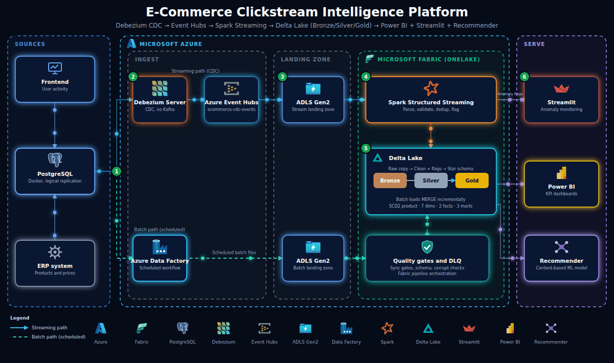

 

# Retail Clickstream Data Engineering Pipeline

**An end-to-end e-commerce clickstream data engineering pipeline integrating batch and real-time streaming ingestion, data processing, anomaly detection, and business intelligence using Microsoft Azure and Fabric.**

  

