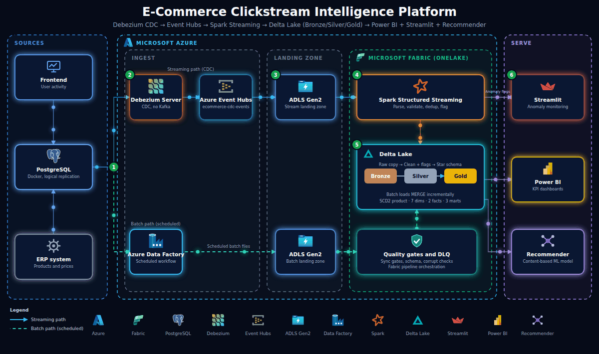

 <div align="center">

# Retail Clickstream Data Engineering Pipeline

**An end-to-end e-commerce clickstream data engineering pipeline integrating batch and real-time streaming ingestion, data processing, anomaly detection, and business intelligence using Microsoft Azure and Fabric.**


</div>


## Motivation & Project Overview

An online retailer produces a click for every product viewed, every item added to a cart and every purchase. At
tens of millions of rows per month these logs are too large, too messy and too late to be useful as-is: they contain
duplicates, bot traffic, missing fields and impossible event sequences, and nobody can answer simple questions
such as *"where do shoppers drop off?"* or *"which channel actually brings revenue?"* straight from the raw files.

This project builds the data platform that turns that raw clickstream into trusted answers. It simulates the data
engineering backbone of an e-commerce company and combines batch and streaming workflows to:

- Replay a real e-commerce clickstream (the REES46 multi-category store dataset, October 2019) from a
  PostgreSQL source system, both as large batch files and as a Change Data Capture (CDC) stream.
- Ingest, validate and clean the events in a **Medallion architecture** (Bronze, Silver, Gold) on Microsoft Fabric,
  with a shared dead-letter queue (DLQ), pipeline metrics and circuit-breaker quality gates.
- Detect and measure realistic data anomalies (bot-like crawling, duplicates, impossible sequences, missing data,
  cart abandonment, promotional surges) against a ground-truth manifest.
- Model the clean data as a Kimball **star schema** (7 dimensions, 2 facts, 3 marts) served to Power BI.
- Turn the same data into a **content-based recommender system** served through FastAPI and Streamlit.

The result is one pipeline that feeds two consumers: business users who need dashboards, and a machine learning
service that needs leakage-free features.

## Business Questions

The platform exists to answer four questions for the business:

| Question | Where it is answered |
|---|---|
| How much are we selling, and how is it changing? | Executive Overview page |
| Which marketing channels and platforms bring revenue? | Marketing Channels and Platform page |
| Where do shoppers drop off between browsing and buying? | Funnel and Product Performance page |
| Which products, brands and categories drive revenue, and what should we show each user? | Product performance marts and the recommender |

## Problem Description

The pipeline addresses practical challenges in clickstream data processing:

- A month of events is about 42.4 million rows (5.28 GB), so it must be processed incrementally instead of
  re-reading everything on each run.
- Events arrive from two different paths, large batch files and a CDC stream, and both must end up in one clean
  and consistent model with one DLQ vocabulary.
- Raw events contain natural problems (13.5M missing category codes, about 6.1M missing brands, 30,220 exact
  duplicate rows) and injected ones (bots, duplicates, impossible sequences). The pipeline must tell the two apart
  and flag suspicious events instead of silently deleting evidence.
- The source has no product catalog or catalog price, so the price history of every product has to be derived from
  the events themselves (SCD Type 2).
- Bad data must never reach executive dashboards, so the pipeline has to stop itself when quality drops.
- Repeated reporting needs tested dimensions, facts and marts rather than querying raw files.

## Architecture Summary

```text
Source system:
PostgreSQL (ecommerce_db: batch / streaming / monitoring schemas)

Batch:
Source files (.csv.gz, 11 columns)
  -> Azure Data Factory -> ADLS Gen2 landing zone
  -> Gate 1 (landing readiness)
  -> OneLake shortcut -> Fabric Spark Structured Streaming (availableNow)
  -> Bronze (raw, immutable Delta)  -> Bronze.events + Bronze.product_catalog

Streaming:
PostgreSQL (logical replication / WAL)
  -> Debezium Server -> Azure Event Hubs -> Event Hubs Capture (Avro)
  -> Bronze.events_stream (CDC payload parsed, timestamps standardized)

Common path:
Bronze
  -> Silver.events (validate, standardize, deduplicate, impute, flag) + Silver.dlq_events + Silver.pipeline_metrics
  -> Silver.dim_product (SCD Type 2)
  -> Gate 2 (DLQ rate / bot rate circuit breaker)
  -> Gold star schema (dimensions, fact_events, fact_sessions) -> marts
  -> Power BI (Direct Lake)   and   Recommender system (FastAPI + Streamlit)

Orchestration: Microsoft Fabric Data Pipeline with Office 365 failure alerts.
```

<p align="center">
  
</p>

*Architecture diagram: batch and streaming ingestion, Medallion layers on Fabric, quality gates, and serving.*

**Why both a batch and a stream path?** In a real company, clicks would arrive only as a stream and the batch path
would carry the product catalog from an ERP system. In this project the student Event Hubs subscription sends too few
events per second to replay a meaningful time range (the first week alone is about 9M events), so the same week is
also delivered as batch files. The stream path then demonstrates real-time CDC ingestion and anomaly monitoring.

## The Dataset

**Source:** REES46 multi-category store, October 2019. One row is one user event (`view`, `cart` or `purchase`).

| Original column | Description |
|---|---|
| `event_time` | UTC timestamp of the event |
| `event_type` | `view`, `cart` or `purchase` (no `remove_from_cart` exists in this dataset) |
| `product_id`, `category_id` | Product and category identifiers |
| `category_code` | Dot-separated taxonomy, e.g. `electronics.audio.headphone` |
| `brand`, `price` | Brand and list price at event time |
| `user_id`, `user_session` | User and session identifiers |

**Added by the data generator (synthetic):**

| Column | Rule |
|---|---|
| `platform` | `Web` if `user_id` is even, otherwise `Mobile App` |
| `marketing_channel` | Derived from `user_id % 6`: Organic Search, Paid Search, Social Media, Email, Direct, Referral |
| `ingestion_time` | Stamped by the pipeline on arrival, never trusted from the producer |

### Data Exploration Baseline

The full month was profiled read-only with Polars (lazy `scan_csv`) before any anomaly was injected, so natural
data issues are never confused with injected ones.

| Metric | Result |
|---|---|
| Rows / columns | 42,448,764 / 9 (about 5.28 GB) |
| Event mix | view 96.07%, cart 2.18%, purchase 1.75% |
| Sessions (non-null) | 9,244,421 (median 2 events, p99 = 32, max 1,159) |
| Missing values | `category_code` 13,515,609, `brand` 6,113,008, `user_session` 2 |
| Exact duplicates | 18,099 groups, 30,220 extra rows |
| Time coverage | 2019-10-01 to 2019-10-31 (UTC) |

Key lessons from the exploration: a large session is not automatically a bot, a missing brand is not automatically an
anomaly, and a single month cannot prove seasonality. Every synthetic scenario is therefore documented as synthetic.

### Injected Anomaly Scenarios (Week 1, 2019-10-01 to 2019-10-07)

Week 1 has 8,829,315 original rows plus 424,489 injected rows, for **9,253,804** rows in total. Every injected row is
described in `anomaly_manifest.csv`, the ground truth. Detection rules never read it; it is only used to evaluate them.

| Anomaly | Rows | How the generator creates it |
|---|---:|---|
| Missing Data | 212,244 | Copy of a source row with one of the 11 columns set to null (the column rotates) |
| Duplicate Events | 42,449 | Copy of a source row with `event_time` + 1 second (same session and product) |
| Impossible Sequences | 42,449 | A `cart` event 1 second after a `purchase` of the same session and product |
| Bot-like Crawling Loops | 53,061 | A repeated `view` of the same session and product 1, 2 or 3 seconds later |
| Cart Abandonment Scenarios | 31,837 | A `cart` event 1 to 10 minutes after a `view`, with no purchase of that product in the session |
| Seasonal Promotional Purchase Surges | 42,449 | Copies of purchases re-timed into a 30-minute window on 2019-10-05 (12:00 to 12:30) with `marketing_channel = seasonal_promotion` |

## Ingestion

### Source system (PostgreSQL)

PostgreSQL 17 runs in Docker (`ecommerce_db`) and acts as the source system, organized into schemas:

| Schema | Purpose |
|---|---|
| `batch` | Data loaded by the batch ingestion pipeline (`batch.ecommerce_events`, all 11 columns) |
| `streaming` | Data used for the streaming simulation and CDC (`streaming.ecommerce_events`, 8 columns) |
| `monitoring` | Ingestion checkpoints (`ingestion_checkpoints`, `streaming_checkpoints`) |

Both loaders use `psycopg`. The batch loader uses `COPY` in 100,000-row transactions; the streaming simulator inserts
100-row batches with a one-second delay. Each loader keeps a checkpoint (source path, file size, file modification
time, last row number) that is updated **in the same transaction** as the data, so an interrupted run resumes safely
and a changed source file or an unknown state stops the script instead of loading duplicates.

### Batch path

Compressed CSV files are extracted by Azure Data Factory into the ADLS Gen2 landing zone and exposed to Fabric through
a OneLake shortcut. `nb_gate_landing` verifies the landing zone before any compute runs, and
`nb_bronze_batch_ingest` reads the files with Spark Structured Streaming and `trigger(availableNow=True)`, which gives
incremental, once-per-file processing similar to Auto Loader.

### Streaming path (CDC)

```text
PostgreSQL -> WAL / logical replication -> Debezium Server -> Azure Event Hubs -> Capture (Avro) -> Bronze.events_stream
```

Debezium Server (`pgoutput` plugin, publication `ecommerce_cdc_pub`, replication slot `ecommerce_cdc_slot`, snapshot
mode `initial`) publishes row changes from `streaming.ecommerce_events` to an Event Hub without Kafka.
`nb_bronze_stream_ingest` reads the captured Avro files, parses the Debezium `after` payload against an explicit CDC
schema, casts IDs to `long`, converts `EnqueuedTimeUtc` (`M/d/yyyy h:mm:ss a`) to a UTC timestamp and keeps a
`_corrupt_record` column so the table mirrors the batch shape.

## Medallion Layers (Microsoft Fabric)

### Bronze: raw, immutable

| Table | Content |
|---|---|
| `Bronze.batch_raw` | All source columns plus `ingestion_time`, `source_file`, `_corrupt_record`. The evidence copy |
| `Bronze.events` | Event columns only, stream-like shape, `source = batch_workaround` |
| `Bronze.product_catalog` | Price and attribute change candidates, an ERP-like feed |
| `Bronze.events_stream` | CDC events parsed from Event Hubs Capture |

Key decisions: an explicit schema (no inference), `price` kept as a string so malformed values survive to Silver, mode
`PERMISSIVE` with `_corrupt_record`, `maxFilesPerTrigger = 20`, and a checkpoint that records processed files. Bronze
tables are append-only because the Delta streaming source fails if upstream rows are updated or deleted. A bug where
`platform` and `marketing_channel` appeared swapped (the schema is applied by column position) was fixed, and the
reader should stay strict (`enforceSchema = false`) so any future order mismatch fails loudly.

### Silver: cleaned, validated, flagged

Design principles: **incremental, never full refresh** (a run costs the size of the new data, not the size of the
table), **idempotent writes** (`MERGE`, so a replayed micro-batch changes nothing) and **reject only structurally
broken events**. Events that are valid but suspicious are flagged, not deleted, so they stay available as evidence.

For each micro-batch `nb_silver_events` validates, standardizes, builds session context (existing Silver rows within a
one-day lookback), deduplicates, imputes `platform` and `marketing_channel` from the same session, flags anomalies and
merges into `Silver.events` (partitioned by `event_date`).

**Validation rules and DLQ reasons** (the first failing rule is recorded):

| Rule | DLQ reason |
|---|---|
| R1: row is parseable | `malformed_row` |
| R2: required fields not null | `null_event_time`, `null_event_type`, `null_user_session`, `null_user_id`, `null_product_id`, `null_price` |
| R3: `event_time` converts to a timestamp | `invalid_event_time` |
| R4: `price` is numeric | `invalid_price` |
| R5: `event_type` is view, cart or purchase | `invalid_event_type` |
| R6: `price > 0` | `non_positive_price` |

**One shared DLQ.** Batch and stream rejections go to a single table, `Silver.dlq_events`, distinguished by `source`
and `entity`. It gives one place for the rejected-event KPI, one vocabulary, and replay logic that differs only by
source. Each row keeps the raw payload, source file, a hash `dlq_id`, and is written with an insert-only `MERGE`, so
re-runs never duplicate rows.

**Standardization.** Strings are trimmed with empty values nulled; `platform` becomes `web` or `mobile`;
`marketing_channel` is normalized and validated against seven values, including the generator's `seasonal_promotion`
marker; prices are rounded to two decimals; and `event_date` / `event_hour` are derived. Missing platform or channel
values are taken from other events of the same session, otherwise `unknown`, with `platform_imputed` and
`channel_imputed` recording what was filled.

**Deduplication** uses the business key `(user_session, event_time, event_type, product_id)`. Rows already in Silver
win, and among equals the row with valid platform and channel wins.

**Anomaly flags** (computed on the full session context; parameters are calibrated to the generator):

| Flag | Definition | Targets |
|---|---|---|
| `is_duplicate_event` | repeat gap in the same session, product and type = 1 second | Duplicate Events |
| `is_bot_like` | `view` repeated 1 to 3 seconds after the previous one | Bot-like Crawling Loops |
| `is_bot_session` | more than 100 views in any 60 seconds, no cart, median gap under 2 seconds | Natural bots |
| `is_impossible_sequence` | `cart` 1 second after a `purchase` of the same session and product | Impossible Sequences |
| `exclude_from_kpis` | duplicate, bot-like or bot session | KPI filtering |

Cart abandonment, purchase-without-view and the promotional surge are session-level or volume anomalies, so they are
not computed per row in Silver. Abandonment is calculated from sessions in Gold, and the surge is a statistical
per-category, per-hour anomaly detected in Gold.

**Silver.dim_product (SCD Type 2).** Because the data has no catalog price, a new product version starts whenever the
price of a product changes, ordered by `event_time` (not `ingestion_time`) so late data does not change the result. A
deterministic surrogate key `product_sk = xxhash64(product_id, valid_from)` allows an atomic `MERGE`, including
removal of versions that disappear when late candidates split or merge versions. Attributes take the latest non-null
value so injected nulls do not create fake versions.

**Metrics and reconciliation.** Every micro-batch appends to `Silver.pipeline_metrics` (`run_id, stage, metric, value,
ts`): rows in, DLQ counts per reason, duplicates removed, rows inserted and rows per flag. Reconciliation after a run:

```text
Bronze rows = Silver rows + DLQ rows + duplicates removed
```

### Gold: star schema for BI and ML

`nb_gold` reads only `Silver.events` and `Silver.dim_product` and builds **7 dimensions, 2 fact tables and 3 marts**,
plus two technical tables (`etl_watermark`, `product_price_band`). Silver is the source of truth; duplicates flagged in
Silver are removed from `fact_events`, and bots are excluded from the marts.

| Layer | Tables | Grain / notes |
|---|---|---|
| Dimensions | `dim_date`, `dim_time`, `dim_platform`, `dim_marketing_channel`, `dim_event_type`, `dim_product`, `dim_user` | `dim_date` and `dim_time` are role-playing (event and ingestion); `dim_product` is SCD2 with an `Unknown` row (`product_key = -1`); `dim_user` is SCD1 |
| `fact_events` | transactional, partitioned by `event_date_key` | One row per unique event; `event_id = sha2(session, time, type, product)`; measures: `event_price` (non-additive), `revenue`, `event_count` |
| `fact_sessions` | accumulating snapshot, partitioned by session start date | One row per session; funnel flags `has_view` / `has_cart` / `has_purchase`, counts, duration, time to first cart, cart value, revenue |
| `mart_executive_marketing` | date x platform x channel | sessions, orders, revenue, first vs returning sessions |
| `mart_funnel_behavior` | date x platform x channel | view / cart / purchase / abandoned sessions, lost revenue, dwell time |
| `mart_product_brand_performance` | date x platform x channel x product | views, carts, purchases, revenue, price band (Low / Mid / High terciles of average view price) |

Why two fact tables? Putting session revenue on every event row of a four-event session would make `SUM(revenue)`
return four times the real value. Separate grains remove the double-counting risk and make funnel queries much faster.

Design choices worth knowing:

- **Marts store only counts and sums.** Ratios (conversion, AOV, abandonment) are computed in Power BI as sum / sum, so
  they stay correct when sliced by any date range or channel.
- **Surrogate keys are hashes** (`xxhash64`) rather than identity columns, which keeps joins on large Delta tables
  cheap and works in Fabric.
- **Incremental load.** Sessions with Silver rows newer than the `etl_watermark` (with a 6-hour overlap) are rebuilt
  completely so flags updated in Silver propagate. Facts are merged, `is_first_session` is corrected for late arrivals,
  and marts are rebuilt for the affected date range with `replaceWhere`, which is atomic and idempotent. The watermark
  moves only after every gate passes.
- **Quality gates in Gold** (pre-write and post-write): required tables and columns exist, no duplicate `event_id` or
  `session_key`, no null keys, positive prices, valid session metrics, `fact_events` matches `fact_sessions` on
  event count and revenue, every `user_key` exists in `dim_user`, and each mart matches its fact in the built range.

## Orchestration & Quality Gates

The Fabric Data Pipeline `Retail_Clickstream_Batch_Pipeline` runs the notebooks as a single sequential chain with a
60-second wait between steps:

```text
nb_gate_landing -> nb_bronze_stream_ingest -> nb_bronze_batch_ingest -> nb_bronze_split
  -> nb_silver_product -> nb_silver_events -> nb_gate_silver -> nb_gold
```

Great Expectations is not available in Fabric, so the gates are notebooks that raise a `ValueError`. A failed gate
stops the pipeline and sends an Office 365 email alert, so `nb_gold` never runs on bad data.

| Gate | Where | What it checks | On failure |
|---|---|---|---|
| Landing readiness (`nb_gate_landing`) | Start of the pipeline | Landing zone is reachable, `.csv.gz` files exist, no 0-byte files, total size at least 50 MB | Stop and email: Landing Zone Extraction Failed |
| CDC schema matching | `nb_bronze_stream_ingest` | CDC JSON matches the typed `cdc_schema`, IDs cast to `long` | Type enforcement |
| Corrupt record catching | `nb_bronze_stream_ingest` | Malformed JSON, schema drift, type mismatches | Isolated in `_corrupt_record` |
| Timestamp standardization | `nb_bronze_stream_ingest` | `EnqueuedTimeUtc` legacy string format | Converted to a UTC timestamp |
| Synchronization (`Wait_2`, `Wait_7`) | Between ingestion and Silver | Batch and stream writes are fully committed | Hold downstream execution |
| Silver circuit breaker (`nb_gate_silver`) | Before Gold | For the latest batch date: DLQ rate at most 5% and bot rate at most 20% | Stop and email: Silver Data Quality Threshold Exceeded |

Both notebook gates retry twice, five minutes apart, and every notebook activity has a 12-hour timeout.

## Anomaly Detection Results

`nb_anomilies_quality_check` compares what Silver detected with the injected ground truth. A sample evaluation run:

| Anomaly | Detected / observed | Injected | Reading |
|---|---:|---:|---|
| Impossible sequences | 42,449 | 42,449 | Exact match |
| Bot-like events | 117,863 | 53,061 | Includes views repeated one second later that also match the duplicate rule, plus natural bots |
| Duplicates removed | 97,911 | 42,449 | Includes natural exact duplicates and missing-data copies whose null is outside the dedup key |
| Missing data (DLQ null / malformed) | 120,145 | 212,244 | Part of the copies are removed by deduplication |
| Abandoned sessions | (Gold) | 31,837 | Session-level, measured in `mart_funnel_behavior` |

DLQ reasons in that run: `null_user_session` 19,296, `null_price` 23,669, `null_user_id` / `null_product_id` /
`null_event_time` / `null_event_type` 19,295 each, and `non_positive_price` 11,252.

A sample Gate 2 run processed 9,155,893 records (9,024,496 good, 131,397 in the DLQ, 117,863 bot records), giving a
DLQ rate of **1.44%** against a 5% limit and a bot rate of **1.31%** against a 20% limit, so the gate passed.

## Business Intelligence (Power BI)

Power BI reads the Gold tables through a semantic model in Direct Lake mode. The report has a cover page, a sidebar
(page navigator, Platform filter, Channel filter, Last Updated), dark and light themes and three pages: **Executive
Overview**, **Marketing Channels and Platform**, and **Funnel and Product Performance**.

### KPI dictionary

| KPI | Formula |
|---|---|
| Total Revenue / Orders | sum of revenue / sessions with at least one purchase |
| Conversion Rate | orders / sessions |
| AOV | revenue / orders |
| View to Cart % | cart sessions / view sessions |
| Cart to Purchase % | purchase sessions / cart sessions |
| Cart Abandonment % | 1 - Cart to Purchase |
| View to Purchase % | purchase sessions / view sessions |
| Lost Revenue | cart value of abandoned sessions |

### What the data shows (sample of about one week, 1 to 7 October 2019)

| Metric | Value |
|---|---|
| Total revenue | about 61.4M |
| Orders / sessions | about 195K / 1.88M |
| Conversion rate / AOV | 10.4% / about 315.53 |
| View to Cart / Cart to Purchase | 7.5% / 91.5% |
| Cart abandonment / View to Purchase | about 8.5% / 6.8% |

- **The funnel leaks before the cart, not at checkout.** Only 7.5% of viewing sessions add to cart, but 91.5% of cart
  sessions purchase.
- **One day dominates the week.** Saturday 5 October brought about 20.9M revenue, roughly a third of the week. The
  seasonal promotion channel is the largest revenue source (about 13.5M, 22%), which matches the injected surge.
- **Revenue is concentrated.** Electronics is about three quarters of revenue (about 47M of 61M); Apple leads brands
  (about 30M), followed by Samsung (about 12M) and Xiaomi (about 2M).
- Web and mobile are balanced, and the other six channels each contribute about 13%.

### Recommendations for the business

1. **Improve View to Cart:** clearer prices, shipping and stock information, recently viewed shortcuts and
   recommendations, better search and navigation.
2. **Plan promotions deliberately:** build a promotion calendar, prepare stock and support, and measure margin rather
   than revenue only.
3. **Reduce revenue concentration:** cross-sell and bundle beyond electronics and review supplier risk for the top brand.
4. **Recover abandoned carts:** reminder emails or push notifications within 24 hours, segmented by platform.
5. **Measure marketing efficiency:** capture ad spend per channel to compute ROAS and CAC, and enforce UTM tagging.
6. **Keep the experience consistent** across web and mobile.

These figures come from about one week of data, so treat them as hypotheses to test, not long-term trends.

## Recommender System

A personalized **content-based recommender** is built on the same data (8.25M interactions, 117,286 products,
709,231 users over 1 to 7 October 2019) and lives in `recommender_system/`.

| Stage | Approach |
|---|---|
| Split | Strict chronological 70/15/15 split to prevent leakage: train 5,773,678 events (Oct 1 to 5), validation 1,237,217 (Oct 5 to 6), hidden test 1,237,224 (Oct 6 to 7) |
| Item features | TF-IDF over product text (`ngram_range=(1,2)`, 4,000 features) fitted on training items only, fused with a log-scaled price feature (`price_weight = 0.0508`) |
| User profiles | Centroid of interacted item vectors with an exponential time decay (8.4-hour half-life) and per-event weights for view, cart and purchase |
| Tuning | Optuna (12 trials) across unweighted, interaction-weighted and time-decayed models; the time-decayed centroid won |
| Ranking | Cosine similarity, excluding items already seen in training |
| Serving | FastAPI backend (port 8000) and Streamlit dashboard (port 8501) |

**Offline results on the hidden test set:** Recall@10 = **2.82%** (over 330x better than random on a 117k catalogue),
HitRate@10 = **5.69%**, catalogue coverage = **47.58%** (it avoids popularity bias). In the demo, Top-8
recommendations return in about 21 ms.

Saved artifacts: `item_matrix.npz` and `tfidf_vectorizer.joblib` (module 1), `profiles.npz`, `seen_items.npz` and
`best_params.json` (module 2), `evaluation.json` (module 3).

## Repository Structure

```text
Retail-Clickstream-Pipeline/
├── clickstream-architecture.gif   # Architecture diagram
├── ingestion/                     # PostgreSQL loaders, CDC / Debezium configuration, data generator
├── spark_jobs/                    # Fabric PySpark notebooks: bronze, silver, gold, gates, quality checks
├── orchestration/                 # Fabric pipeline definition and manifest
├── data_model/                    # Gold star schema, physical model and mart SQL
├── dashboards/                    # Power BI report
├── recommender_system/            # Content-based recommender, FastAPI and Streamlit apps
├── imgs/                          # Images used in the documentation
├── requirements.txt               # Python dependencies
└── README.md
```

## Setup & Reproducibility

### Prerequisites

- Docker (PostgreSQL 17) and Python 3.9+
- An Azure subscription with an ADLS Gen2 storage account (landing zone), Azure Data Factory and an Event Hubs
  namespace with Capture enabled
- A Microsoft Fabric workspace with a Lakehouse (schemas `Bronze`, `Silver`, `Gold`) and Power BI
- Debezium Server and a PostgreSQL user with replication permissions

Never commit passwords, connection strings, storage keys or Event Hubs credentials; use environment variables or a
secrets store.

### 1. Provision Azure and Fabric

1. Create a resource group and a StorageV2 account with Hierarchical Namespace enabled; set up an Azure Cost Management
   budget alert before creating paid services.
2. Create a Fabric Lakehouse and the schemas, then add a OneLake shortcut (Lakehouse Files, New shortcut, ADLS Gen2) to
   the landing container. The identity needs the Storage Blob Data Reader role.
3. Use these Spark settings in the notebooks: `spark.sql.session.timeZone = UTC`, `spark.sql.ansi.enabled = false`,
   and Fabric optimize-write enabled.

### 2. Load the source database

Start PostgreSQL 17 in Docker, create the `batch`, `streaming` and `monitoring` schemas, then run the batch loader and
the streaming simulator from `ingestion/`.

### 3. Enable CDC (optional streaming path)

Set `wal_level = logical` (and restart PostgreSQL), create the publication and replication slot, configure Debezium
Server with the Azure Event Hubs sink, and choose the initial snapshot behavior deliberately so existing rows are not
replayed by accident. Verify the flow by inserting a row and confirming the event reaches Event Hubs.

### 4. Run the pipeline

Import the notebooks into Fabric, import the pipeline definition from `orchestration/` and update the notebook IDs,
workspace ID and Office 365 connection. Run `Retail_Clickstream_Batch_Pipeline` from the Fabric Pipeline Monitor. To run
the steps manually, use this order: `nb_gate_landing`, `nb_bronze_stream_ingest`, `nb_bronze_batch_ingest`,
`nb_bronze_split`, `nb_silver_product`, `nb_silver_events`, `nb_gate_silver`, `nb_gold`.

To reprocess after a rule change, drop `Silver.events` and `Silver.dim_product`, delete their checkpoint folders, clear
the related rows in `Silver.pipeline_metrics` and the batch rows in `Silver.dlq_events`, and run again. To reload Bronze,
drop the Bronze tables and the Bronze checkpoint together. The first Gold run must start from empty Gold tables.

### 5. Run the recommender

```bash
pip install -r requirements.txt
cd recommender_system
uvicorn app.api:app --port 8000
streamlit run app/dashboard.py
```

## Known Limitations & Open Items

- **Scope differences between documents.** The profiling covers the full month (42.4M rows); the pipeline, Gold layer
  and recommender cover the first week (about 8.25M to 9.25M events, depending on whether injected anomalies are
  counted). Week 2 uses different anomaly parameters (exact duplicates, a different promotion window), so the
  evaluation settings must be changed for it.
- **Detection parameters are tuned to the generator** and must be documented as such. Bot-like and duplicate events
  cannot be separated for views repeated after one second.
- **Impossible sequences are flagged but kept in KPIs** until the funnel rule is agreed by the team.
- **`seasonal_promotion` behaves like a seventh marketing channel** and has no cost, which affects channel ROI. Decide
  whether it remains a campaign marker or is mapped back to the user's real channel.
- **One purchase row is one item** (no quantity), so deduplication also collapses two legitimate same-second purchases
  of the same product.
- **`ingestion_delay_seconds` is not meaningful** (about 7 years) because event times are from 2019 and ingestion times
  are from 2026, until a replay clock exists.
- **Late price changes** alter `product_sk` in Silver; old Gold events keep their old key and are not relinked.
- **Dashboard items to resolve:** the channel relationship in the semantic model (channel-level funnel metrics show
  identical values), one cart-abandonment definition (an earlier measure showed about 44% against about 8.5% from the
  funnel), and the session revenue column. Month-over-month comparisons need more history.
- **Streaming verification:** full delivery of every record to Event Hubs through Debezium should be confirmed with
  end-to-end evidence before it is presented as validated.

## Tech Stack

- **Cloud:** Microsoft Azure (ADLS Gen2, Data Factory, Event Hubs), Microsoft Fabric (Lakehouse, Data Pipeline, OneLake)
- **Source and CDC:** PostgreSQL 17 (Docker), Debezium Server
- **Processing:** Apache Spark (PySpark, Structured Streaming), Delta Lake, Polars (exploration)
- **Modeling and BI:** Kimball star schema, Power BI (Direct Lake)
- **ML and serving:** scikit-learn (TF-IDF), Optuna, FastAPI, Streamlit
